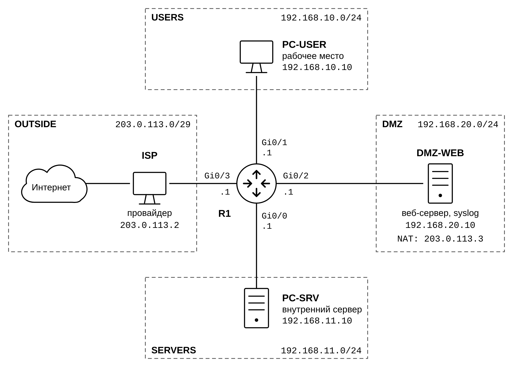
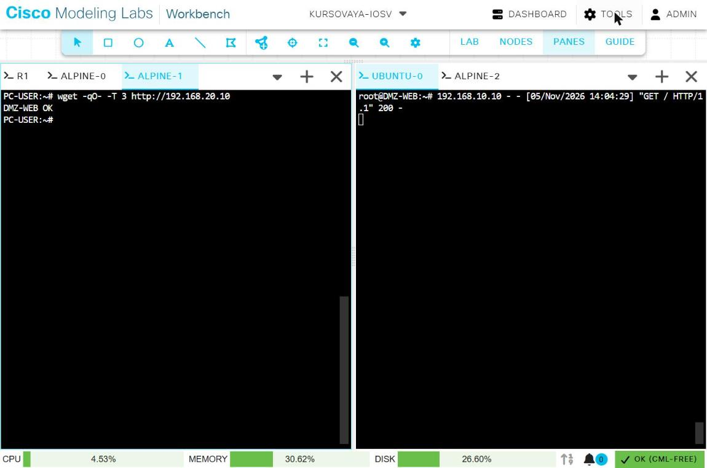
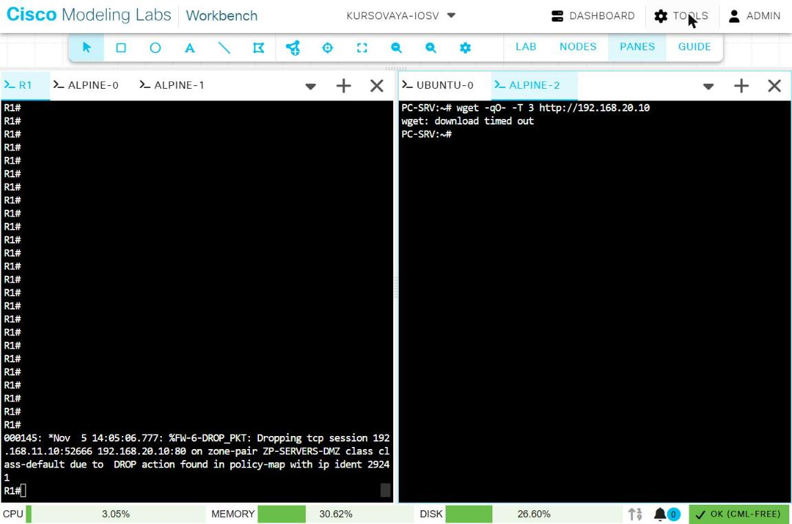
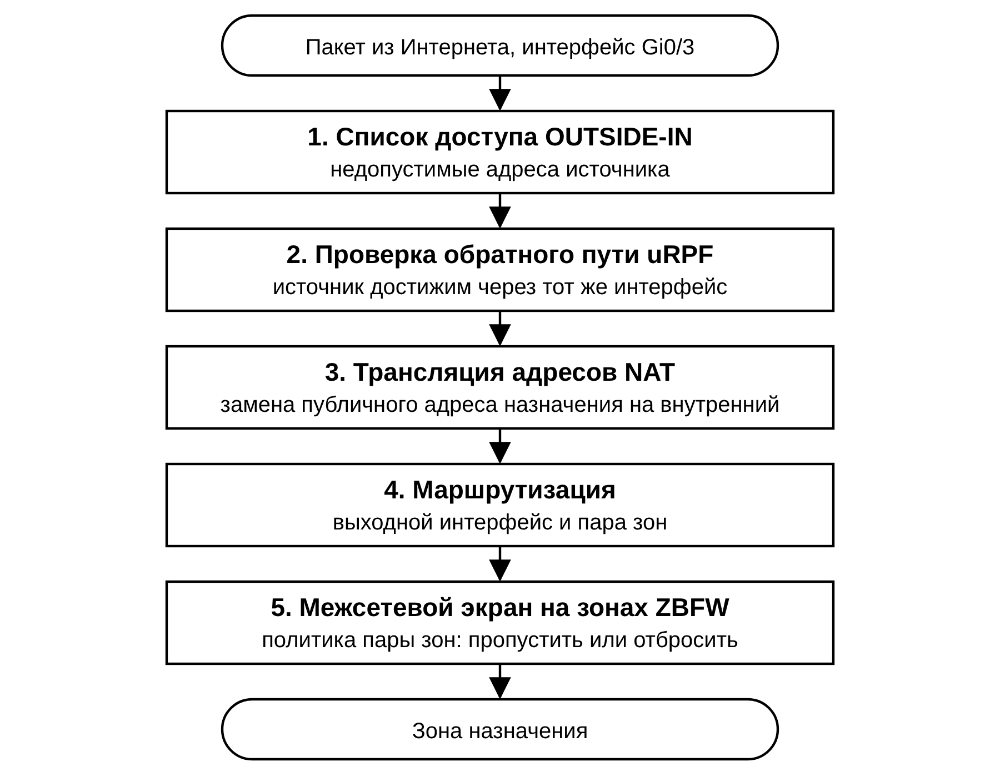
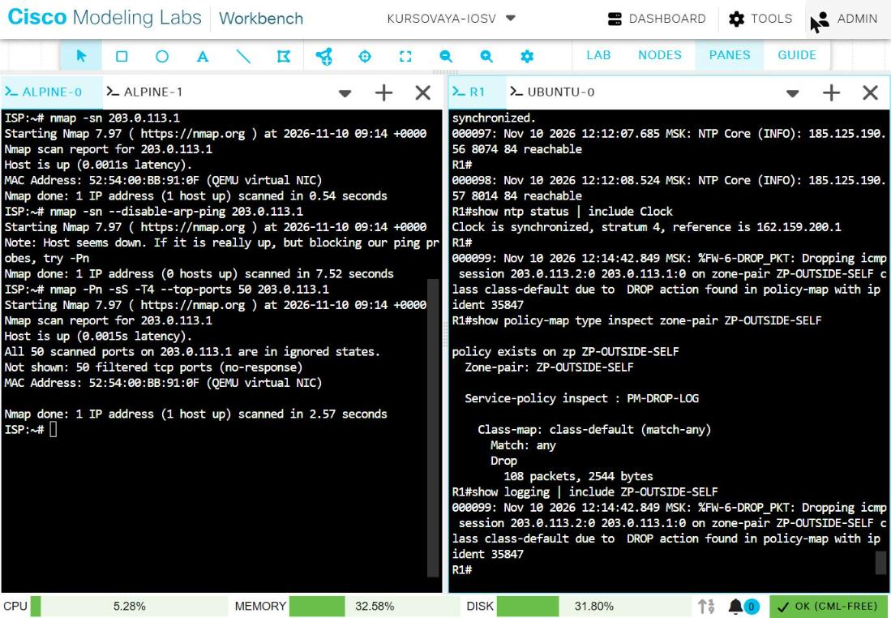
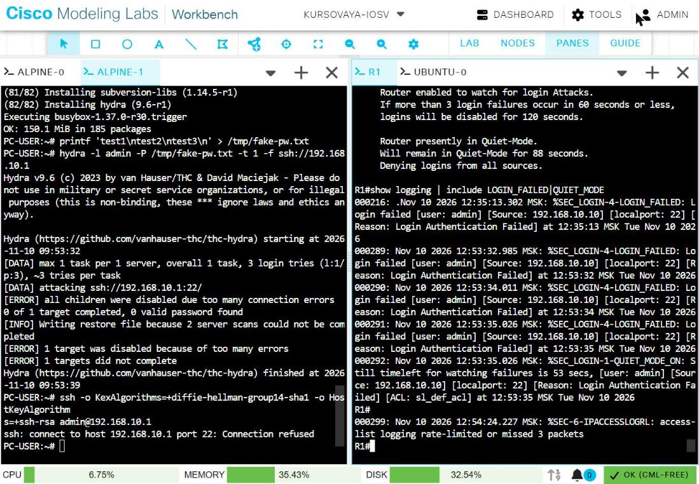

# Защищённый сегмент сети на маршрутизаторе Cisco


Учебный проект: сеть малого предприятия с демилитаризованной зоной (DMZ) и выходом в Интернет, построенная на одном маршрутизаторе Cisco. Вся защита настроена на маршрутизаторе R1, каждая мера проверена по схеме «до и после», итоговая конфигурация испытана атаками с внешнего узла.



## Что сделано

| № | Задача | Решение | Команды |
|---|--------|---------|---------|
| 1 | Адресация и маршрутизация | Четыре сети на четырёх интерфейсах, маршрут по умолчанию к провайдеру | [01_addressing_routing](config/steps/01_addressing_routing.txt) |
| 2 | Защита управления | Пароли scrypt, SSH v2 только из сети пользователей, блокировка подбора пароля, роли, журнал команд | [02_management](config/steps/02_management.txt) |
| 3 | Защита от подмены адресов | uRPF на всех интерфейсах, входной список на внешнем интерфейсе | [03_antispoofing](config/steps/03_antispoofing.txt) |
| 4 | Разграничение доступа | Zone-Based Policy Firewall: 4 зоны, 20 пар зон, запрет по умолчанию | [04_zone_firewall](config/steps/04_zone_firewall.txt) |
| 5 | Выход в Интернет, публикация сервера | PAT для внутренних сетей, static NAT для веб-сервера | [05_nat](config/steps/05_nat.txt) |
| 6 | Учёт событий | Время по NTP, журнал на отдельном сервере | [06_time_logging](config/steps/06_time_logging.txt) |
| 7 | Проверка защиты | 60 проверок «до и после», 8 атак (nmap, hping3, hydra) | [screenshots](screenshots/) |

Полная итоговая конфигурация: [config/R1_running-config.txt](config/R1_running-config.txt).

## Узлы стенда

| Узел | Сегмент | Адрес | Роль |
|------|---------|-------|------|
| R1 | – | `.1` в каждой сети | Пограничный маршрутизатор и межсетевой экран, Cisco IOSv |
| PC-USER | USERS | `192.168.10.10` | Рабочее место сотрудника и администратора |
| PC-SRV | SERVERS | `192.168.11.10` | Узел сегмента внутренних серверов |
| DMZ-WEB | DMZ | `192.168.20.10` | Веб-сервер nginx, снаружи виден как `203.0.113.3`; сервер журналов rsyslog |
| ISP | OUTSIDE | `203.0.113.2` | Провайдер и внешний пользователь; при проверках – источник атак |

Блок `203.0.113.0/29` взят из диапазона TEST-NET-3 (RFC 5737) и играет роль публичных адресов.

## Политика доступа

Кто имеет право начинать соединение. Ответы на разрешённые соединения проходят автоматически.

| Откуда \ куда | USERS | SERVERS | DMZ | Интернет | R1 |
|---------------|:-----:|:-------:|:---:|:--------:|:--:|
| **USERS** | – | SSH, HTTP, HTTPS, ping | ✅ | ✅ | SSH, ping |
| **SERVERS** | ⛔ | – | ⛔ | ✅ | ping |
| **DMZ** | ⛔ | ⛔ | – | ✅ | ping |
| **Интернет** | ⛔ | ⛔ | только TCP 80, 443 | – | ⛔ |
| **R1** | ✅ | ✅ | ✅ | ✅ | – |

Главное требование: клиент из сегмента USERS имеет доступ в DMZ, клиент из сегмента SERVERS не имеет.

| USERS → DMZ: доступ есть | SERVERS → DMZ: отказ |
|:---:|:---:|
|  |  |

## Рубежи защиты

Пакет, пришедший из Интернета, проходит проверки в таком порядке:

<p align="center"></p>

## Результаты атак

Атаки проводились с узла ISP внутри изолированного стенда. Конфигурация R1 во время атак не менялась.

| Угроза | Инструмент | Чем остановлена | Результат |
|--------|------------|-----------------|-----------|
| Разведка портов маршрутизатора | nmap | Пара зон `ZP-OUTSIDE-SELF` | 50 портов filtered, счётчик отказов 0 → 108 |
| Разведка веб-сервера | nmap | Static NAT и пара `ZP-OUTSIDE-DMZ` | Видны только порты 80 и 443 |
| Раскрытие версии веб-сервера | curl | `server_tokens off` на сервере | Версия в ответах скрыта |
| Выход к внутренним сетям | traceroute, nmap | NAT и экран | Узлы недостижимы |
| Подмена адреса источника | hping3 | Список `OUTSIDE-IN` и uRPF | Счётчики +3 и +3, до сервера дошло 0 пакетов |
| Поток пакетов, перегрузка журнала | hping3 | Экран и ограничение частоты журнала | Отброшены все пакеты, 4 записи на 2200 отказов |
| Подбор пароля SSH извне | hydra | Пара `ZP-OUTSIDE-SELF` | Соединение не устанавливается |
| Подбор пароля SSH изнутри | hydra | `login block-for` | Блокировка на 120 с после трёх попыток |

<details>
<summary>Снимки экрана: сканирование маршрутизатора и подбор пароля</summary>





</details>

## Структура репозитория

```
├── config/
│   ├── R1_running-config.txt   итоговая конфигурация R1, хеши паролей скрыты
│   ├── steps/                  команды по шести шагам настройки, с комментариями
│   └── hosts/                  настройка узлов Linux: провайдер, клиенты, веб-сервер
├── diagrams/                   схема сети и порядок обработки пакета (PNG, SVG)
├── screenshots/                90 снимков экрана: состояние до и после, проверки, атаки
└── report/
    ├── CR_1.pdf                курсовая работа, полный текст
    └── CR_2.pdf                пояснительная записка, краткое изложение
```

Имена снимков начинаются с номера шага: `3-…` – защита управления, `4-…` – подмена адресов, `5-…` – межсетевой экран, `6-…` – трансляция адресов, `7-…` – время и журнал, `8-…` – атаки.

## Как воспроизвести

1. Cisco Modeling Labs 2.10, узлы: один IOSv 15.9(3)M12, три Alpine Linux, один Ubuntu 24.04, внешний соединитель в режиме NAT.
2. Соединить узлы по схеме и настроить Linux-узлы по файлам из [config/hosts](config/hosts/).
3. Ввести на R1 команды из [config/steps](config/steps/) по порядку номеров. В файле `02_management.txt` заменить `<ПАРОЛЬ>` своими паролями.
4. Сравнить результат с [config/R1_running-config.txt](config/R1_running-config.txt).

## Ограничения

Это учебный стенд, а не готовая конфигурация для рабочей сети.

- Журнал маршрутизатора хранится на веб-сервере DMZ: в стенде не более пяти узлов. В реальной сети сервер журналов размещают во внутреннем сегменте.
- Исходящий трафик не ограничен: все сегменты могут обращаться в Интернет по любым протоколам.
- IOS 15.9 поддерживает обмен ключами SSH только на основе SHA-1.
- Вся защита находится на одном устройстве без резерва.
- Экран проверяет адреса и порты, но не содержимое соединений.

Все атаки выполнялись внутри изолированной лаборатории против собственных узлов.
